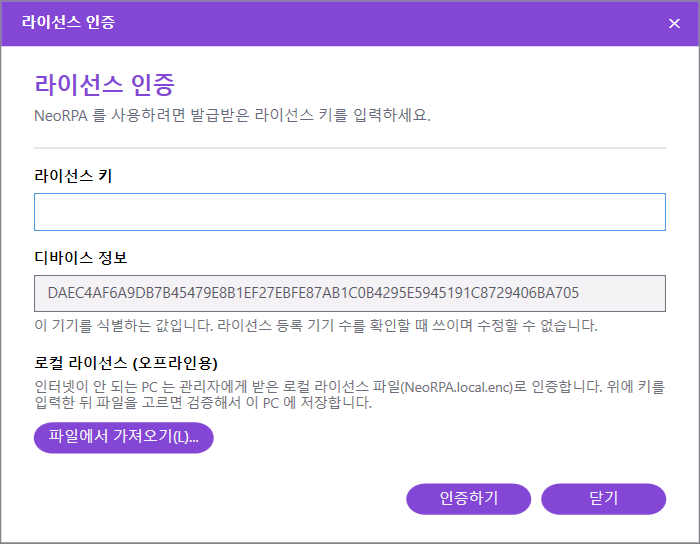
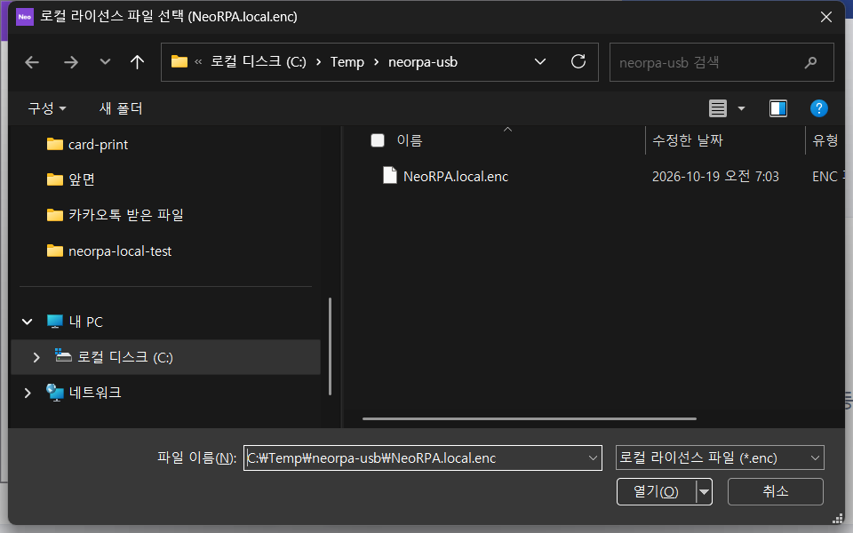
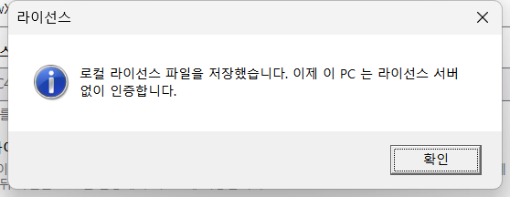
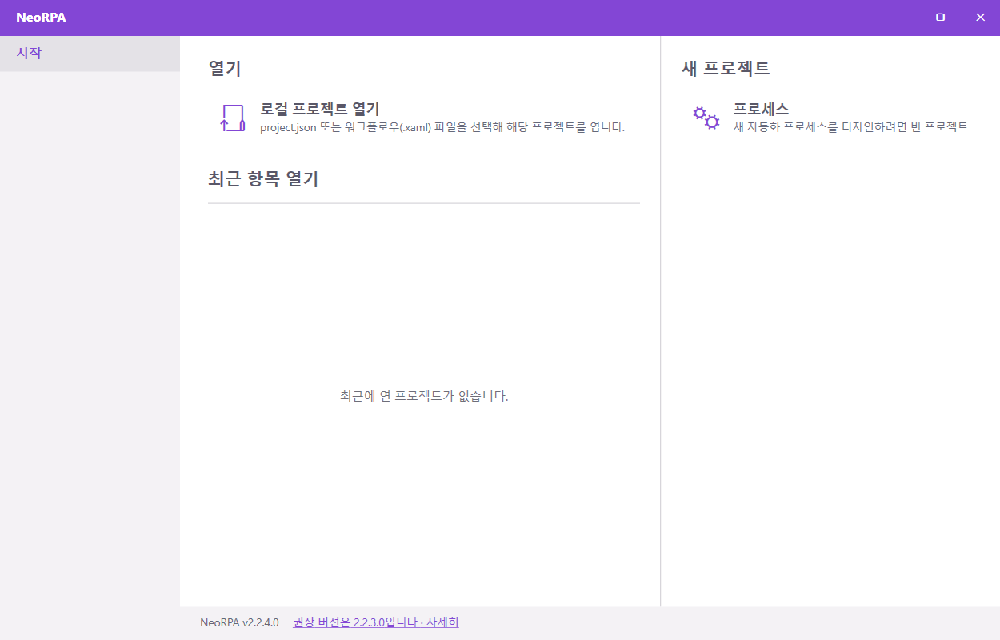

# 인터넷이 안 되는 PC 에서 라이선스 인증하기 (로컬 라이선스)

NeoRPA 는 보통 실행할 때 라이선스 서버에 접속해 라이선스를 확인합니다. 인터넷이 안 되는(폐쇄망) PC 에서는 담당자에게 받은 **로컬 라이선스 파일**(`NeoRPA.local.enc`)을 한 번 넣어 두면 이후에는 서버 없이 인증됩니다. NeoRPA 2.2.4.0 이상에서 할 수 있습니다.

## 1. 디바이스 정보 확인

NeoRPA 를 실행하면 "라이선스 인증" 창이 뜹니다. 창 **아래쪽 "디바이스 정보"** 에 이 PC 를 구별하는 64자 값이 있습니다. 라이선스를 요청할 때 담당자에게 **이 값**을 함께 보냅니다. 이미 NeoRPA 를 쓰고 있는 PC 라면 리본 → **라이선스 정보** 창에도 같은 값이 있습니다.

## 2. 담당자에게 받기

담당자가 **라이선스 키**와 **`NeoRPA.local.enc` 파일**을 보내 줍니다. 파일은 받은 그대로 두세요. 메모장 등으로 열어 저장하면 파일이 손상되어 쓸 수 없습니다.

## 3. 파일 가져오기

1. "라이선스 인증" 창의 **라이선스 키** 칸에 받은 키를 입력합니다.
2. **[파일에서 가져오기…]** 를 누르고 받은 `NeoRPA.local.enc` 를 고릅니다.

3. "로컬 라이선스 파일을 저장했습니다. 이제 이 PC 는 라이선스 서버 없이 인증합니다." 가 뜨면 [확인]을 누릅니다.

4. 시작 화면이 열리면 끝입니다. 이후에는 인터넷 없이 실행됩니다.

!!! tip "이미 NeoRPA 를 쓰고 있는 PC"
    리본 → **라이선스 정보** 창에도 같은 [파일에서 가져오기…] 버튼이 있습니다.

## 4. 나중에 파일을 다시 받아야 할 때

로컬 라이선스 파일에는 받은 시점의 정보가 들어 있습니다. 아래 경우 담당자가 새 파일을 보내 주면 3 번처럼 다시 가져옵니다.

- 라이선스 기간을 연장했을 때
- 같은 라이선스로 쓰는 PC 를 추가하거나 바꿨을 때
- 담당자가 라이선스 내용을 바꿨다고 알려 줄 때

## 문제가 있을 때

| 메시지 | 뜻 | 할 일 |
|---|---|---|
| 로컬 라이선스 파일(NeoRPA.local.enc)을 선택하세요 | 다른 파일을 골랐습니다 | 담당자에게 받은 `NeoRPA.local.enc` 를 고르세요 |
| 선택한 파일이 이 라이선스 키의 것이 아닙니다 | 키를 잘못 입력했거나 다른 라이선스의 파일입니다 | 키를 다시 확인하세요. 계속되면 담당자에게 문의 |
| 이 PC 는 아직 이 라이선스에 등록되어 있지 않습니다 | 이 PC 의 디바이스 정보가 라이선스에 등록되지 않았습니다 | 1 번의 디바이스 정보를 담당자에게 보내 등록을 요청하고, 새 파일을 받아 다시 가져오세요 |
| 검증에 실패해 저장하지 않았습니다 | 파일이 전달 중에 바뀌었습니다 | 담당자에게 파일을 다시 받아 그대로 가져오세요 |
| 키를 입력하고 [인증하기]를 눌렀는데 "라이선스 서버에 연결할 수 없습니다" | 아직 로컬 라이선스 파일을 가져오지 않았습니다 | 3 번을 하세요 |
